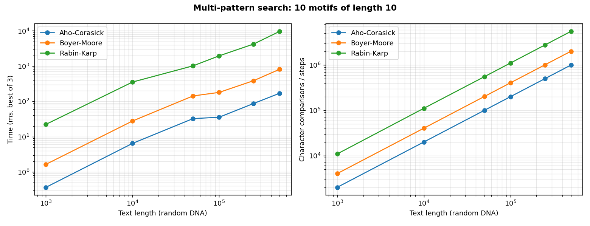
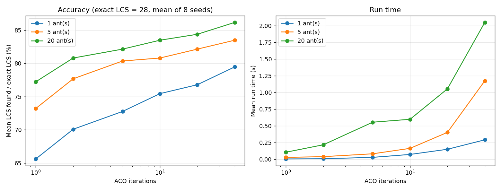
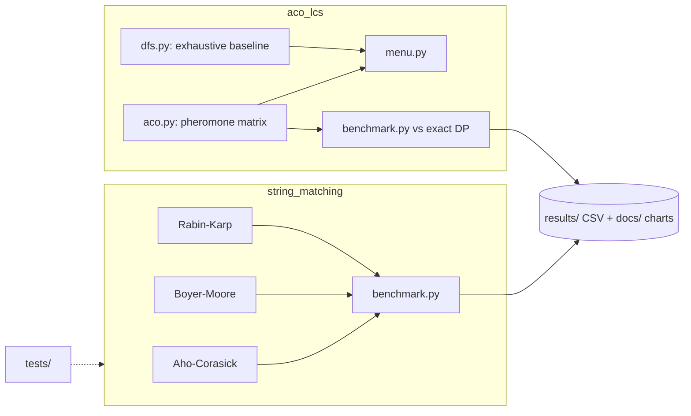

<p align="center">
  
</p>

<p align="center">
  
</p>

<p align="center">
  
  
  
  
  
  
</p>

<p align="center">
  
  <br/><sub>Real benchmark produced by <code>python -m string_matching.benchmark</code>: 10 random DNA motifs of length 10 searched in random texts of 1k to 500k characters.</sub>
</p>

## 📑 Table of contents

- [Overview](#-overview)
- [Features](#-features)
- [Results](#-results)
- [Architecture](#-architecture)
- [Tech stack](#-tech-stack)
- [Requirements](#-requirements)
- [Installation and configuration](#-installation-and-configuration)
- [Usage](#-usage)
- [Project structure](#-project-structure)
- [Testing](#-testing)
- [Troubleshooting and FAQ](#-troubleshooting-and-faq)
- [Roadmap](#-roadmap)
- [Contributing](#-contributing)
- [License](#-license)
- [Author](#-author)

## 🌍 Overview

**Problem:** searching many patterns in a large text is expensive with repeated scans, and finding a longest common subsequence (LCS) of long sequences is expensive to do exhaustively.

**Solution:** this repository implements three classic exact matchers (Aho-Corasick, Boyer-Moore, Rabin-Karp) with built-in comparison counters, plus an Ant Colony Optimization (ACO) heuristic for LCS compared against an exhaustive DFS baseline and a dynamic-programming reference. Benchmarks are scripted so every chart can be regenerated.

## ✨ Features

- **Aho-Corasick** automaton (trie plus failure links built by BFS) for multi-pattern search in a single pass.
- **Boyer-Moore** (bad-character rule) for single patterns.
- **Rabin-Karp** rolling-hash search with false-positive counting.
- **ACO for LCS**: ants walk the alignment grid (down / right / diagonal), deposit pheromone proportional to the matches found, and evaporation keeps exploration alive. Multiple sequences are handled by chaining pairwise results.
- **Exhaustive DFS baseline** that enumerates every path of the grid, plus an interactive console menu comparing ACO, DFS and a dynamic-programming reference.
- **Instrumented code**: the matchers return their own comparison counters next to the matches, so complexity can be compared independently of wall-clock noise.
- Unit tests that check every matcher against a naive scan on random inputs.

## 📊 Results

### String matching (random DNA, 10 patterns of length 10)

| Text length | Aho-Corasick | Boyer-Moore (x10) | Rabin-Karp (x10) |
| --- | --- | --- | --- |
| 10,000 | 6.5 ms | 27.9 ms | 353 ms |
| 100,000 | 35.6 ms | 180 ms | 1.95 s |
| 500,000 | 170 ms | 813 ms | 9.62 s |

Aho-Corasick takes about one pass over the text regardless of the number of patterns, while the other two re-scan the text once per pattern. All three agree on the matches (asserted in the benchmark). The raw numbers are in `results/benchmark_string_matching.csv`; the original experiment spreadsheets from the coursework are kept in `results/*.xlsx`.

### ACO versus exact LCS



| Setting | Mean accuracy vs exact LCS |
| --- | --- |
| 1 ant, 1 iteration | about 66% |
| 20 ants, 40 iterations | about 86% (roughly 2 s per run) |

Context: the pair of 41-character sequences has an exact LCS of 28 (computed by dynamic programming). ACO is a heuristic, so it trades exactness for a tunable accuracy/time curve. Averages over 8 random seeds; data in `results/benchmark_aco_lcs.csv`.

## 🏗 Architecture



## 🧰 Tech stack

| Layer | Technology |
| --- | --- |
| Language | Python 3.12 |
| Numerics / data | NumPy, pandas, openpyxl |
| Plots | Matplotlib |
| Tests | `unittest` |

## 📋 Requirements

| Item | Requirement |
| --- | --- |
| OS | Windows, macOS or Linux |
| Python | 3.12 (verified with 3.12.3); `pip` |
| Libraries | `numpy`, `pandas`, `matplotlib`, `openpyxl` (see `requirements.txt`, unpinned) |
| Hardware | CPU only; each benchmark takes about a minute |
| Display | Only `aco_lcs/demo_animation.py` needs a graphical display |
| Accounts / API keys | None |
| Disk | Under 5 MB |

## 🔧 Installation and configuration

```bash
git clone https://github.com/ORD1STAR/string-matching-and-aco-algorithms.git
cd string-matching-and-aco-algorithms
python -m venv .venv
source .venv/bin/activate        # Windows: .venv\Scripts\activate
pip install -r requirements.txt
```

**Environment variables:** none; there are no secrets or config files.

## 🎮 Usage

```bash
python -m unittest discover -s tests         # correctness tests
python -m string_matching.benchmark          # ~1 minute, writes results/ and docs/
python aco_lcs/benchmark.py                  # ~1 minute
python aco_lcs/menu.py                       # interactive ACO / DFS demo
python aco_lcs/demo_animation.py             # pheromone matrix animation (needs a display)
```

## 🗂 Project structure

<details>
<summary>Show tree</summary>

```
string_matching/
  aho_corasick.py   trie + failure links
  boyer_moore.py    bad-character heuristic
  rabin_karp.py     rolling hash, single and multi pattern
  benchmark.py      reproducible benchmark and chart
aco_lcs/
  aco.py            ACO for LCS (pheromone matrix, evaporation)
  dfs.py            exhaustive path enumeration baseline
  menu.py           interactive console comparison
  parameter_study.py  grid search over ants / iterations / evaporation (long running)
  benchmark.py      ACO vs exact DP, produces the chart above
  demo_animation.py pheromone matrix animation
tests/              unittest suite
results/            CSV and spreadsheet results
docs/               charts
```

</details>

## 🧪 Testing

```bash
python -m unittest discover -s tests
```

The suite checks every matcher against a naive scan on random inputs (4 tests; all pass in a verification run).

## 🛠 Troubleshooting and FAQ

<details>
<summary>ModuleNotFoundError: No module named 'string_matching'</summary>

Run the benchmark from the repository root with `python -m string_matching.benchmark`, not from inside the package folder.
</details>

<details>
<summary>The animation script fails or shows nothing</summary>

`demo_animation.py` needs a graphical Matplotlib backend. On a headless server, use the benchmarks and the menu instead.
</details>

<details>
<summary>Why are some identifiers in French?</summary>

These are teaching implementations written for a university algorithms course, so identifiers and comments are partly in French.
</details>

<details>
<summary>The DFS option never finishes</summary>

The DFS baseline enumerates every grid path and is exponential; use it only for very short strings.
</details>

## 🗺 Roadmap

- [ ] Dictionary-suffix links in Aho-Corasick: `AhoCorasick.recherche` currently reports the pattern stored at the current node only, so it is exact for patterns that are not suffixes of one another
- [ ] Independent bases and moduli for the three Rabin-Karp hashes (they currently share one, behaving like a single hash)
- [ ] Good-suffix rule for Boyer-Moore (only bad-character is implemented)
- [ ] Finish a Commentz-Walter implementation (an unfinished coursework attempt was left out)

## 🤝 Contributing

Issues and pull requests are welcome. Please add or extend a test in `tests/` for any matcher change.

## 📄 License

Released under the [MIT License](LICENSE).

## 👤 Author

<table>
  <tr>
    <td><b>Hannoun Amine Amar</b><br/>AI Engineer / Fullstack Developer, Algeria</td>
    <td>
      <a href="https://www.linkedin.com/in/hannoun-amine/"></a>
      <a href="https://github.com/ORD1STAR"></a>
      <a href="mailto:hannoun.amine25@gmail.com"></a>
    </td>
  </tr>
</table>

<p align="center">
  
</p>
